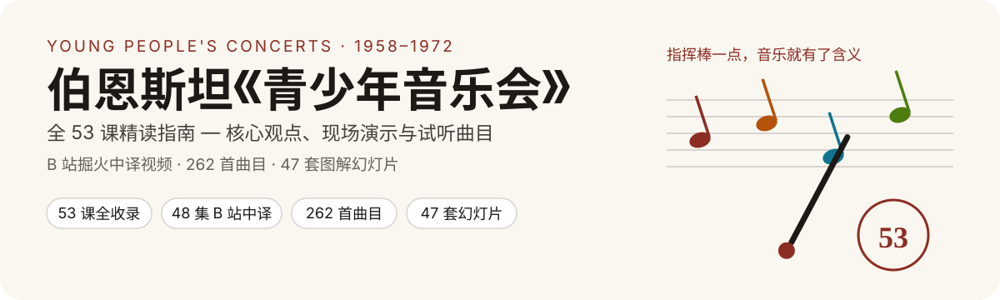
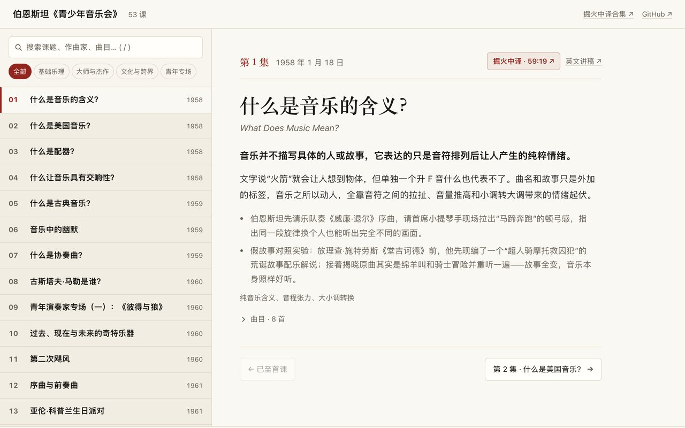

<p align="right"><a href="README.md">中文</a></p>

<p align="center">
  
</p>

<p align="center">
  <a href="https://xiaosang.cc/bernstein-ypc/">▶ Read Online</a>
  ·
  <a href="https://github.com/holynova/bernstein-ypc">GitHub Repository</a>
</p>

A study guide to all 53 episodes of Leonard Bernstein's *Young People's Concerts* (1958–1972): each episode gets a core thesis, a plain-language explainer, and live stage demonstrations, in a two-column reading interface with search and category filters — plus Bilibili Chinese-subtitled videos, a 262-track repertoire (146 with audio previews), and 47 illustrated slide decks.

## Screenshots

<p align="center">
  
</p>

<p align="center">
  
</p>

## Contents

- **All 53 episodes** (1958–1972): from Episode 1 《什么是音乐的含义？》 ("What Does Music Mean?") through Episode 53, each with a core thesis, a plain-language explainer, live demonstration scenes, and key concepts.
- **4 categories**: 基础乐理 music fundamentals (19), 大师与杰作 masters & masterpieces (14), 文化与跨界 culture & crossover (10), 青年专场 young artists (10).
- **Bilibili videos**: 48 episodes link to Chinese-subtitled videos by 掘火档案 (a Bilibili collection); every episode also links to the original English lecture script on leonardbernstein.com.
- **Repertoire**: 262 performed pieces in total, 146 with Apple Music audio previews, in a collapsible track list you can listen through one by one.
- **Illustrated slide decks**: all 53 decks, 15 pages each (795 pages total), readable in-page or fullscreen online only (no downloads).

## Features

- **Two-column reading interface**: index on the left, text on the right, with one-click jumps to the previous or next episode.
- **Search**: by episode topic, composer, or piece name (press `/` to open).
- **Category filters**: filter by any of the 4 categories in one click.
- **Slide reader**: page through and read each episode's illustrated deck in-page, fullscreen.

## Run Locally

```bash
npm install
npm run dev
```

Verify the data (that the 53-episode list matches the slide decks):

```bash
npm test
```

## Tech

- Vanilla JavaScript + Vite, zero frontend framework dependencies; data is static JSON (`src/data/`), and the whole site can be statically hosted.
- The dataset and slides are generated by Python scripts (`scripts/build_dataset.py`, `build_slides.py`, `ppt_cycle.py`); `scripts/verify.mjs` checks consistency.

```
src/data/episodes.json    All 53 episodes: theses, explainers, scenes, videos, tracks
src/data/index.json       Episode index (for the table of contents / search)
src/data/slides.json      53 slide-deck mappings (15 pages each, online viewing only)
public/static/            795 slide images (webp)
src/main.js / render.js   UI logic and rendering (including the slide reader)
src/audio.js              Audio preview playback
```
