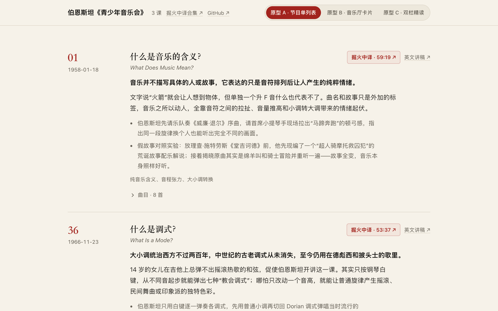

# Bernstein's Young People's Concerts / 伯恩斯坦《青少年音乐会》

中文：整理伦纳德·伯恩斯坦《青少年音乐会》（1958–1972）每课核心观点、通俗讲解与现场演奏例子，附带 B 站“掘火中译”视频与可折叠试听曲目单，目前包含第 1、36、50 集与三种排版原型（节目单列表 / 音乐厅卡片 / 双栏精读）。

English: An interactive study guide to Leonard Bernstein's *Young People's Concerts* (1958–1972), presenting verified concise takeaways, real concert-hall demonstrations, Bilibili Chinese-subtitled video links, and collapsible track previews across three switchable layout prototypes (Ep 1, Ep 36, and Ep 50 pilot).



## 在线体验 / Live Demo

- [Cloudflare Demo](https://xiaosang.cc/bernstein-ypc/)
- [GitHub Repo](https://github.com/holynova/bernstein-ypc)


## 本地运行 / Run locally

```bash
npm install
npm run dev
```

## 发布 / Deploy

```bash
npm run deploy
```

Cloudflare Workers · Subpath Route: `xiaosang.cc/bernstein-ypc/*`

源码与部署配置使用同一个 `main` 主分支；在本地手动构建并部署，不创建 Cloudflare 专用分支或 GitHub Action。
