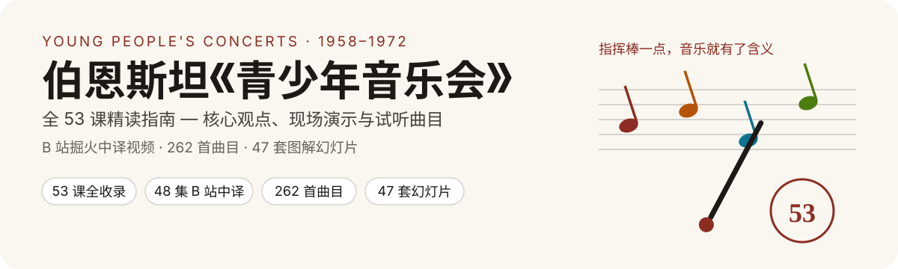
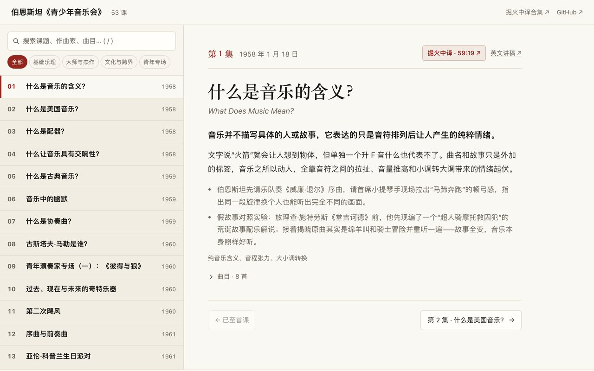

<p align="center">
  
</p>

<p align="center">
  <a href="https://xiaosang.cc/bernstein-ypc/">▶ 在线精读 Read Online</a>
  ·
  <a href="https://github.com/holynova/bernstein-ypc">GitHub 仓库</a>
</p>

整理伦纳德·伯恩斯坦《青少年音乐会》（1958–1972）全部 53 课：每课有核心观点、通俗讲解与现场演奏例子，双栏目录精读界面，支持课程搜索与分类筛选；附 B 站「掘火中译」视频、262 首曲目单（146 首可试听）与 47 套图解幻灯片。

A study guide to all 53 episodes of Leonard Bernstein's *Young People's Concerts* (1958–1972): each episode gets a core thesis, a plain-language explainer, and live stage demonstrations, in a two-column reading interface with search and category filters — plus Bilibili Chinese-subtitled videos, a 262-track repertoire (146 with audio previews), and 47 illustrated slide decks.

## 截图 / Screenshots

<p align="center">
  
</p>

<p align="center">
  
</p>

## 内容 / Contents

- **53 课全收录**（1958–1972）：第 1 集《什么是音乐的含义？》到第 53 集，每课含核心观点、通俗讲解、现场演示场景与概念词。
- **4 个分类**：基础乐理 19 课、大师与杰作 14 课、文化与跨界 10 课、青年专场 10 课。
- **B 站视频**：48 集附「掘火档案」中译视频链接（B 站合集），另附每课英文讲稿原文链接（leonardbernstein.com）。
- **曲目单**：共 262 首现场演奏曲目，146 首带 Apple Music 试听预览，可折叠展开逐首试听。
- **图解幻灯片**：47 套，每套 15 页（共 705 页），站内可翻页全屏阅读，另有 PDF 版；第 1、9、11、22、30、37 集暂无幻灯片。

## 功能 / Features

- **双栏精读界面**：左侧目录、右侧正文，上下集一键跳转。
- **搜索**：按课题、作曲家、曲目名搜索（`/` 唤起）。
- **分类筛选**：4 个分类一键过滤。
- **幻灯片阅读器**：站内翻页、全屏阅读每集图解幻灯片。

## 本地运行 / Run Locally

```bash
npm install
npm run dev
```

数据校验（53 集清单与幻灯片是否一致）：

```bash
npm test
```

## 技术 / Tech

- 纯 JS + Vite，零前端框架依赖；数据是静态 JSON（`src/data/`），整站可静态托管。
- 数据集与幻灯片由 Python 脚本生成（`scripts/build_dataset.py`、`build_slides.py`、`ppt_cycle.py`），`scripts/verify.mjs` 做一致性校验。

```
src/data/episodes.json    53 集正文数据：观点、讲解、场景、视频、曲目
src/data/index.json       课程索引（目录 / 搜索用）
src/data/slides.json      47 套幻灯片映射（每套 15 页）
public/slides/            47 套幻灯片 PDF
public/static/            705 页幻灯片图片（webp）
src/main.js / render.js   界面逻辑与渲染（含幻灯片阅读器）
src/audio.js              试听播放
```

## English

**Bernstein's Young People's Concerts** — a study guide to all 53 episodes (1958–1972), each with a core thesis, a plain-language explainer, and the live demonstrations Bernstein staged with the orchestra.

- **53 episodes, 4 categories**: music fundamentals (19), masters & masterpieces (14), culture & crossover (10), young artists (10).
- **Video**: 48 episodes link to Chinese-subtitled Bilibili videos (uploader 掘火档案); every episode links to the original English lecture script on leonardbernstein.com.
- **Repertoire**: 262 performed pieces, 146 with Apple Music audio previews, in a collapsible track list per episode.
- **Slide decks**: 47 illustrated decks, 15 pages each (705 pages total), readable in-page or fullscreen, with PDF versions; episodes 1, 9, 11, 22, 30, 37 have no deck yet.
- **Run it**: `npm install && npm run dev`. Verify the data with `npm test`.
- **Tech**: vanilla JavaScript + Vite, zero frontend framework dependencies; static JSON data; Python scripts generate the dataset and slides.
